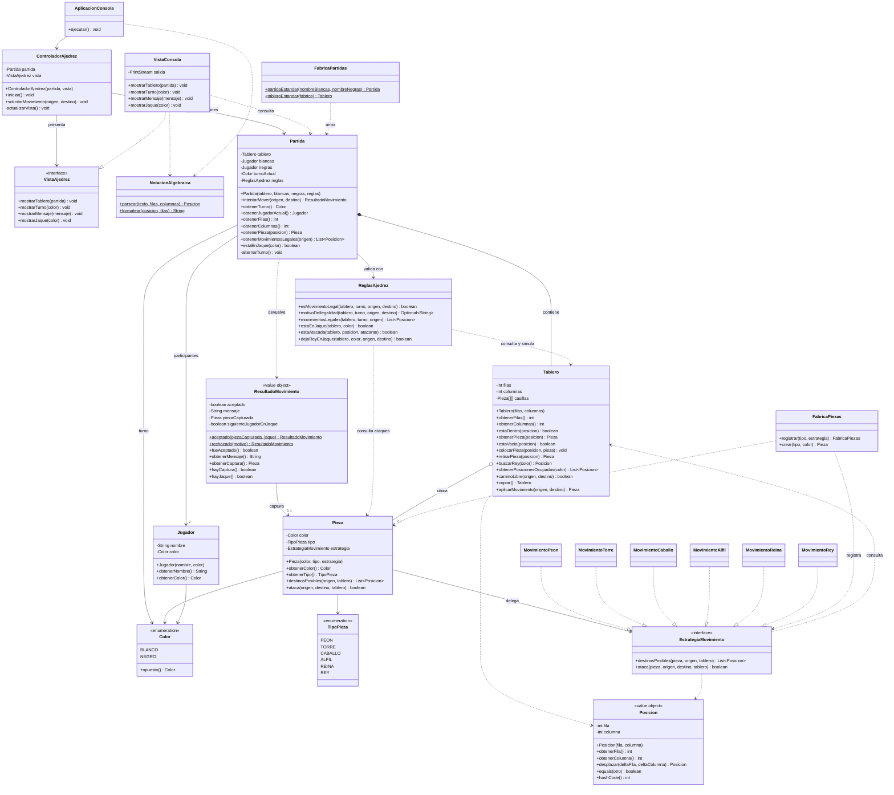

# Diagrama de clases (UML)

Refleja el código real del repositorio. Se renderiza directamente en GitHub.

> `Recorridos` (helper interno package-private del paquete `movimiento`) no se dibuja a propósito.
